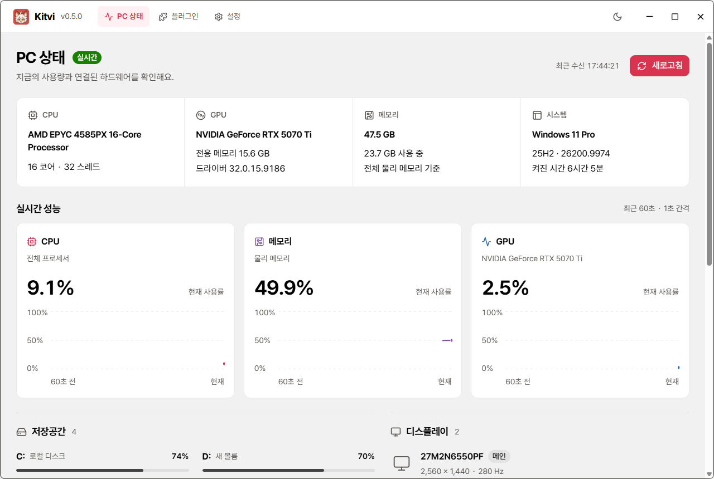

<p align="center"></p>
<h1 align="center">Kitvi</h1>
<p align="center">Your PC at a glance. More tools through plugins.</p>
<p align="center"><a href="README.md">한국어</a> · <strong>English</strong><br><a href="https://github.com/popop098/Kitvi/releases">Downloads / releases</a> · <a href="docs/plugin-guide.md">Plugin authoring</a> · <a href="https://github.com/popop098/Kitvi/issues/new">Report an issue</a></p>

Kitvi is a Windows PC dashboard for CPU, memory and GPU usage, hardware, Windows uptime, storage, monitors and devices. The application UI is currently Korean. **0.6.0 Preview** keeps community plugins off by default and adds a first-use warning plus separate review of each plugin's author, contact, source and permissions.

This repository publishes Kitvi's source, build instructions, releases and issues. Kitvi-authored source code is [MIT-licensed](LICENSE). Branding and third-party components have separate terms described in [BRANDING.md](BRANDING.md) and [THIRD_PARTY_NOTICES.md](THIRD_PARTY_NOTICES.md).



## Get started

1. Download `Kitvi-Setup-<version>-x64.exe` from [Releases](https://github.com/popop098/Kitvi/releases).
2. Install and launch Kitvi. Releases bundle Electron and a self-contained .NET collector, so no separate Node.js, .NET or WebView2 installation is needed.
3. PC metrics work offline. App and plugin automatic version checks can be disabled in Settings.

Fully extract the portable `Kitvi-<version>-win-x64.zip` into a new folder. Portable builds check versions but do not install updates in place. Installed builds use **Settings → check for updates → download → restart to install**. Active media work blocks update restart. Users of 0.3.0 or portable builds must manually install an installer build once to use in-app installation.

Windows 11 x64 has been used for primary validation. Windows 10 22H2 x64 is a compatibility target without separate hardware validation. Consult each release's notes for its actual test scope. This Preview is **unsigned**. Compare downloads with the release's `SHA256SUMS.txt`; a checksum does not authenticate the publisher or guarantee safety. App updates use TLS and checksums without publisher code-signature verification.

## Features

- CPU, memory and per-GPU usage every second with 60-second graphs; dedicated VRAM and driver versions.
- Windows information and uptime, storage every five seconds, monitor and device inventory every fifteen seconds.
- GPU selection and explicit `—` values when metrics are unavailable. GPU usage uses the busiest engine of that adapter. Device status comes from Windows and does not infer Bluetooth connectivity.
- Pretendard, light/dark appearance and custom frameless window controls.
- Explicit app update download and restart installation, plugin installation from GitHub Releases or local ZIP, and plugin enable/disable/removal.

## Plugins

Community plugins are **off by default**. Read and accept the warning when first enabling the feature. Global feature consent and individual plugin consent are separate. Before installing or enabling a plugin, review and accept its **author, email, source and permissions**. Legacy SDK 1 packages without an email show **미등록 (unregistered)**.

Author names and emails are self-declared and are not identity-verified by Kitvi. A GitHub source, checksum or published source is neither a safety guarantee nor a Kitvi endorsement. Choose only needed plugins from sources you trust. Read the [security boundaries and reporting guide](docs/security.md).

SDK 1 runs static HTML/CSS/JavaScript in a sandbox iframe. It provides no Node, direct filesystem, shell, arbitrary executable or native-backend access. The host checks enabled state, declared permissions and arguments for its scoped APIs.

Plugin checks run only while the plugin system is enabled. Automatic checks fetch GitHub release metadata at startup and every six hours; users apply updates from the installed list. Updates with the same GitHub source, publisher, contact and permissions retain consent and the enabled choice. Publisher, contact or permission changes, and local ZIP replacements, disable activation until fresh consent. Saved settings are retained, and active media work prevents replacement.

The [YT Downloader example](https://github.com/popop098/kitvi-YT-downloader) uses a separately installed official yt-dlp engine for a public single YouTube video, saved as single-file video or original audio with progress and cancellation. It exposes no FFmpeg merge, MP3 conversion, login or cookie support. See the [SDK 1 authoring guide](docs/plugin-guide.md) and example repository. Packages using `authorEmail` must set `minKitviVersion` to `0.6.0` or later; `apiVersion` remains `1`.

## Build from source

Use **Windows x64, Node.js 24 or later and the .NET 10 SDK**. The repository builds independently; no previous Kitvi checkout or private tool directory is required.

```powershell
git clone https://github.com/popop098/Kitvi.git
cd Kitvi
npm ci --no-audit --no-fund
npm run setup:electron
npm run typecheck
npm test
npm run test:native
npm start
```

`setup:electron` installs the Electron binary. Native builds select `DOTNET_EXE`, then `.tools/dotnet/dotnet.exe` inside the checkout if present, then `dotnet` on PATH. `.tools` is not published and the script does not install an SDK. Set `DOTNET_EXE` to an installed .NET 10 executable if it is unavailable on PATH.

| Command | Purpose |
| --- | --- |
| `npm run typecheck` / `npm test` | TypeScript checks / JavaScript and host logic tests |
| `npm run test:native` | .NET collector checks |
| `npm run build` | Type checks and complete UI/collector build |
| `npm start` | Build and launch the real PC dashboard |
| `npm run design:preview` / `npm run design:dev` | Collector-free design preview / watch UI changes |
| `npm run package` | Generate NSIS installer, portable ZIP and update metadata without publishing |

`electron/` contains the host, `renderer/` the React UI, `shared/` shared contracts, `native/` the .NET collector, and `scripts/` build tools. Generated output goes to `build/`, `native/publish/` and `release/`.

## Data and network

Hardware and metric history are not uploaded. Graph history stays in memory. Settings, plugins, the engine and error logs are stored in `%LOCALAPPDATA%\Kitvi`, shared with public versions from 0.4.0 onward. Design previews use `.cache/design-profile` inside the checkout.

Update, plugin and engine operations contact GitHub. Video operations contact YouTube and its CDNs. The engine is fetched from its official upstream only on request and checked against SHA256; it is not bundled in Kitvi or the example plugin ZIP.

## Contributing and feedback

[Open an issue](https://github.com/popop098/Kitvi/issues/new) for ordinary bugs or ideas. Include Kitvi/Windows versions, relevant hardware, reproduction steps, expected behavior and observed behavior. Redact private paths and sensitive information. Follow the [security reporting guide](docs/security.md) before publicly posting vulnerability details.

Send focused Pull Requests with a clear purpose. Include relevant tests and validation results for behavior changes, and screenshots for UI changes. Discuss plugin permission or host API contract changes in an issue first. Original code contributions use this repository's MIT license; preserve the source and license of external code and assets.

## Licenses

Kitvi-authored source code uses the [MIT license](LICENSE). That code license does not cover the Kitvi name, fox mascot, icons or other branding; see [BRANDING.md](BRANDING.md). Third-party components retain their own licenses, documented in [THIRD_PARTY_NOTICES.md](THIRD_PARTY_NOTICES.md), [`licenses/`](licenses/) and release notices.
