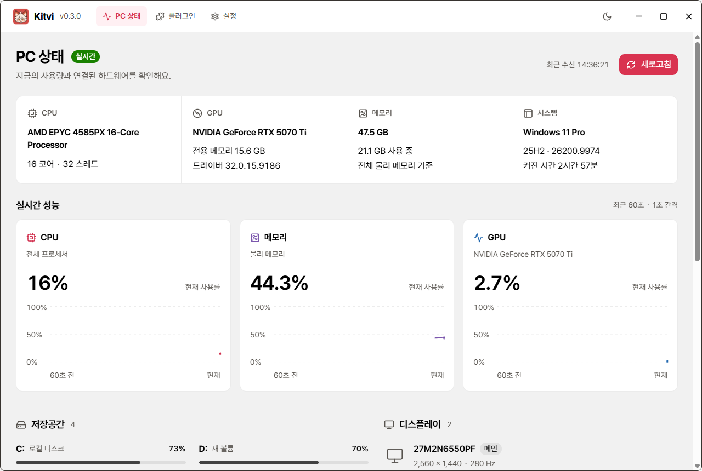

<h1 align="center">Kitvi · 킷비</h1>

내 PC의 지금을, 한눈에. 필요한 기능은 플러그인으로.

 

<strong>한국어</strong> · <a href="README.en.md">English</a> <a href="https://github.com/popop098/Kitvi/releases/download/v0.4.0/Kitvi-Setup-0.4.0-x64.exe">Windows 설치 파일</a> · <a href="https://github.com/popop098/Kitvi/releases/tag/v0.4.0">릴리스·포터블 ZIP</a> · <a href="https://github.com/popop098/Kitvi/issues/new">문제 제보</a>

Kitvi는 CPU·메모리·GPU와 Windows, 저장공간, 모니터, 장치를 확인하는 Windows용 PC 대시보드입니다. **0.4.0 Preview**부터 GitHub Releases 업데이트와 커뮤니티 플러그인을 지원합니다.

앱 소스는 비공개이며, 이 저장소는 배포 파일·사용 안내·이슈를 관리합니다. [YT Downloader 예제와 플러그인 제작 가이드](https://github.com/popop098/kitvi-YT-downloader)는 별도 공개 저장소에서 제공합니다.

## 시작하기

1. [Kitvi-Setup-0.4.0-x64.exe](https://github.com/popop098/Kitvi/releases/download/v0.4.0/Kitvi-Setup-0.4.0-x64.exe)를 다운로드해 설치합니다.
2. Kitvi를 실행합니다. Node.js·.NET·WebView2를 따로 설치할 필요가 없습니다.
3. PC 상태는 오프라인에서도 확인합니다. 설정에서 업데이트 확인 방식을 선택할 수 있습니다.

**기존 0.3.0은 이번 설치 파일을 한 번 직접 설치해야 합니다.** [포터블 ZIP](https://github.com/popop098/Kitvi/releases/download/v0.4.0/Kitvi-0.4.0-win-x64.zip)은 전체를 새 폴더에 풀어 실행하세요. ZIP은 버전 확인만 지원하며 앱 안에서 새 버전을 설치하지 않습니다.

| 환경 | 확인 범위 |
| --- | --- |
| Windows 11 x64 | 실행 및 주요 기능 검증 |
| Windows 10 22H2 x64 | 호환성 대상, 별도 실기 검증 전 |

현재 코드 서명이 없는 Preview입니다. 공식 릴리스의 [SHA256SUMS.txt](https://github.com/popop098/Kitvi/releases/download/v0.4.0/SHA256SUMS.txt)로 파일을 대조할 수 있습니다. 업데이트는 TLS·체크섬을 사용하며 게시자 코드 서명 검증은 제공하지 않습니다.

## PC 상태

| 영역 | 제공하는 내용 |
| --- | --- |
| 실시간 사용률 | CPU·메모리·GPU를 1초마다 측정, 최근 60초 그래프 |
| 하드웨어 | CPU·물리 메모리, GPU별 전용 VRAM·드라이버·사용률 |
| Windows | 운영체제 정보와 가동 시간 |
| 저장공간 | 드라이브별 용량·사용량을 5초마다 갱신 |
| 모니터·장치 | 모니터 모델·해상도·주사율, Windows 장치 상태를 15초마다 갱신 |
| 화면 | Pretendard, 밝게·어둡게, 직접 제작한 창 헤더 |

GPU가 여러 개면 선택할 수 있으며 누락된 값은 0%로 바꾸지 않습니다. GPU 사용률은 해당 어댑터의 가장 바쁜 엔진을 기준으로 집계합니다. 장치의 정상 표시는 Windows가 보고한 상태이며 Bluetooth 주변 기기의 실제 연결을 추정하지 않습니다.

## 업데이트

시작 시 새 버전을 확인하고 설정에서도 수동 확인할 수 있습니다. 새 버전이 있으면 **다운로드 → 다시 시작하여 설치**를 직접 선택합니다. 진행 중인 미디어 작업이 있으면 설치를 위한 재시작을 막습니다. 자동 확인은 설정에서 끌 수 있습니다.

## 플러그인

플러그인 화면에서 GitHub 저장소를 입력하거나 로컬 `.kitvi-plugin.zip`을 선택하세요. 가져오기만으로 설치하지 않으며 제작자·출처·권한을 확인한 뒤 설치합니다. 켜기·끄기·삭제도 이 화면에서 관리합니다.

**첫 예제: [YT Downloader](https://github.com/popop098/kitvi-YT-downloader)** — 저장소 `popop098/kitvi-YT-downloader`를 가져와 설치하세요. 공식 yt-dlp 엔진 설치 후 공개 YouTube 영상 한 편을 단일 영상 파일 또는 원본 오디오로 저장합니다. 진행률과 취소를 지원합니다. 고화질 스트림 병합·MP3 변환·로그인·쿠키는 지원하지 않습니다.

[플러그인 제작 가이드](https://github.com/popop098/kitvi-YT-downloader/blob/main/PLUGIN_GUIDE.md)에는 SDK 1 매니페스트, 격리된 HTML/CSS/JS 화면, 호스트 API, 패키징과 GitHub Release 배포를 설명합니다. 현재 임의 Node 백엔드나 실행 파일 플러그인은 지원하지 않습니다.

## 데이터와 연결

PC 하드웨어와 측정 이력은 외부 서버로 보내지 않습니다. 그래프는 실행 중 메모리에만 보관합니다. 설정·플러그인·오류 로그는 `%LOCALAPPDATA%\Kitvi`에 저장합니다.

새 버전 확인·플러그인 가져오기·엔진 설치에는 GitHub 통신이, 영상 조회·저장에는 YouTube와 영상 CDN 통신이 발생합니다. 다운로더 엔진은 요청할 때 공식 배포처에서 받고 SHA256을 검증합니다. 엔진 EXE는 예제 ZIP에 포함하지 않습니다.

## 문제 제보와 라이선스

[이슈](https://github.com/popop098/Kitvi/issues/new)에 Kitvi·Windows 버전, 관련 장치 모델, 재현 순서와 실제 동작을 적어 주세요. 스크린샷·로그의 개인 경로와 민감한 정보를 가려 주세요.

Kitvi 자체와 브랜딩 자산에는 오픈소스 라이선스를 부여하지 않습니다. 외부 구성 요소의 라이선스는 [제3자 고지](THIRD_PARTY_NOTICES.md) 및 배포 파일에 포함됩니다. 예제 플러그인 코드는 별도 저장소의 MIT 라이선스를 따릅니다.
